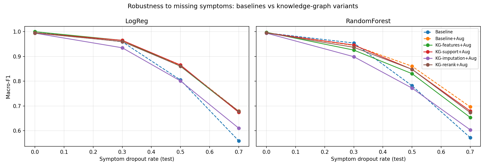

# Knowledge-Graph-Enhanced Disease Prediction

Hybrid pipeline combining an open biomedical knowledge graph (**Hetionet v1.0**, Disease–presents–Symptom edges) with machine-learning classifiers to predict diseases from symptoms, with a focus on **robustness to missing symptoms**, **explainability**, and **data quality**.

**Stack:** Python, pandas, scikit-learn, NetworkX, matplotlib (Google Colab)

## Data
- Symptom–disease dataset (Kaggle/https://www.kaggle.com/datasets/kaushil268/disease-prediction-using-machine-learning): 4962 raw rows → **305 unique records** after de-duplication (prevents train/test leakage), 41 diseases, 131 symptoms.
- Knowledge graph: Hetionet — 133 diseases, 412 symptoms (MeSH), 3357 DpS edges.
- Mapping coverage (manual, see `symptom_mapping.csv`, `disease_mapping.csv`): **85/131 symptoms**, **16/41 diseases** (some disease matches are approximate).

## Method
Test-time symptom dropout (0–70%) simulates incomplete patient reports. 5 stratified 70/30 splits; identical dropped test sets across variants.

| Variant | Description |
|---|---|
| Baseline | One-hot symptoms, trained on complete records |
| Baseline+Aug | + training-time symptom dropout augmentation |
| KG-features+Aug | + KG disease-support and symptom-expansion features |
| KG-support+Aug | + KG disease-support features only |
| KG-imputation+Aug | Missing symptoms softly imputed from KG symptom similarity (shared diseases) |
| KG-rerank+Aug | Classifier probabilities re-ranked by KG disease support (weight tuned on validation) |

Models: Logistic Regression, Random Forest.

## Results (macro-F1, mean ± std over 5 splits)

### Logistic Regression
| Variant | 0% dropout | 30% dropout | 50% dropout | 70% dropout |
|---|---|---|---|---|
| Baseline | 1.000 ± 0.000 | 0.959 ± 0.009 | 0.805 ± 0.017 | 0.559 ± 0.029 |
| Baseline+Aug | 0.995 ± 0.007 | 0.960 ± 0.017 | 0.863 ± 0.019 | 0.679 ± 0.053 |
| KG-features+Aug | 1.000 ± 0.000 | 0.965 ± 0.016 | 0.860 ± 0.018 | 0.675 ± 0.062 |
| KG-support+Aug | 0.995 ± 0.006 | 0.965 ± 0.013 | 0.866 ± 0.036 | 0.674 ± 0.071 |
| KG-imputation+Aug | 0.994 ± 0.008 | 0.935 ± 0.040 | 0.801 ± 0.055 | 0.610 ± 0.052 |
| KG-rerank+Aug | 0.995 ± 0.007 | 0.960 ± 0.017 | 0.861 ± 0.018 | 0.679 ± 0.054 |

### Random Forest
| Variant | 0% dropout | 30% dropout | 50% dropout | 70% dropout |
|---|---|---|---|---|
| Baseline | 0.995 ± 0.006 | 0.954 ± 0.022 | 0.782 ± 0.031 | 0.572 ± 0.027 |
| Baseline+Aug | 0.995 ± 0.007 | 0.945 ± 0.016 | 0.861 ± 0.053 | 0.696 ± 0.066 |
| KG-features+Aug | 0.998 ± 0.005 | 0.926 ± 0.029 | 0.831 ± 0.036 | 0.654 ± 0.065 |
| KG-support+Aug | 0.995 ± 0.006 | 0.946 ± 0.022 | 0.848 ± 0.038 | 0.680 ± 0.066 |
| KG-imputation+Aug | 0.994 ± 0.008 | 0.899 ± 0.031 | 0.772 ± 0.032 | 0.604 ± 0.046 |
| KG-rerank+Aug | 0.995 ± 0.007 | 0.937 ± 0.025 | 0.848 ± 0.046 | 0.673 ± 0.071 |

**Key finding:** At 50% symptom dropout (macro-F1 averaged over both models), the best knowledge-graph variant (**KG-support+Aug**) scored **0.857** vs **0.862** for the augmented baseline (Δ = -0.005; better in 5/10 paired runs). Training-time symptom dropout alone changed the baseline from 0.793 to 0.862. Naively appending KG features to a model trained on complete data reduced robustness in an earlier run (v1).

## Explainability
Each prediction is traced to supporting Disease–presents–Symptom edges in the KG. On a 50%-dropout test set with KG-support+Aug (LogReg): 38% of predictions fall on KG-mapped diseases, and 71% of those have ≥1 supporting KG edge (`explanations.csv`).

## Data-quality layer
Records are checked against KG knowledge: share of a record's KG-mapped symptoms linked to its labelled disease. Results: {'OK': 54, 'LOW': 54, 'INCONSISTENT': 3}. LOW flags likely reflect a mix of approximate disease mappings, sparse symptom coverage in Hetionet, and possible label noise; they are candidates for manual review rather than confirmed errors. (`data_quality_flags.csv`).

## Limitations
- Hetionet covers only 16/41 dataset diseases; several mappings are approximate.
- The dataset is small and synthetic-like (near-perfect accuracy on complete records), so results are indicative only.
- Future work: larger KGs (e.g. PrimeKG), ontology-based mapping (UMLS/MeSH), real clinical data.

## How to run
Open `kg_disease_prediction_v2.ipynb` in Google Colab, upload the dataset zip to `/content`, Runtime → Run all.
